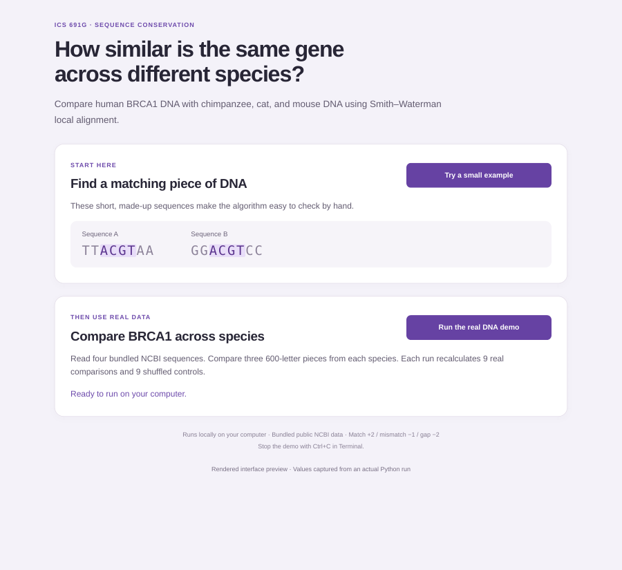
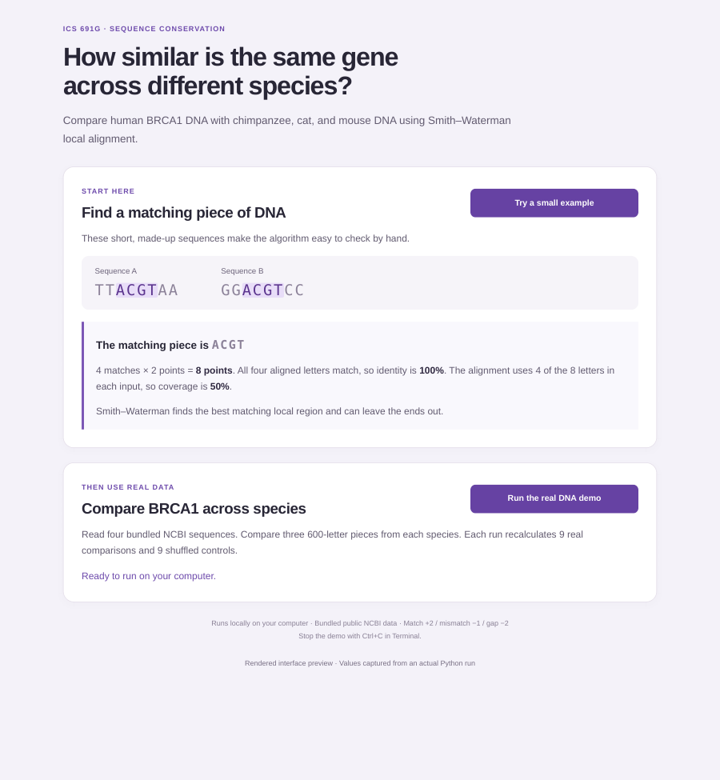
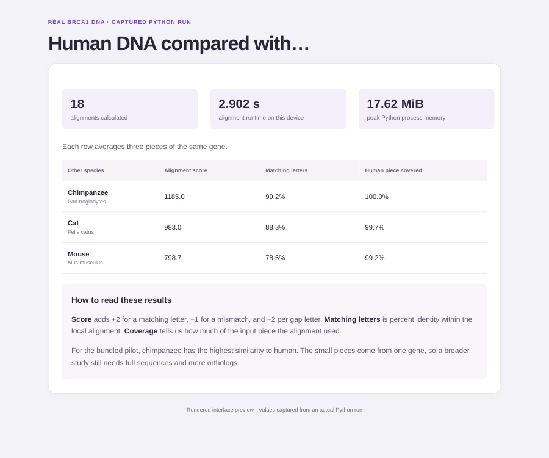
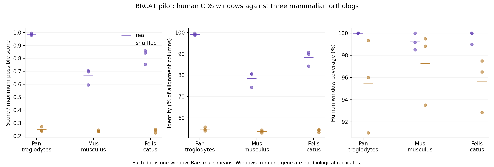

# Sequence conservation across species

## What this project investigates

**How conserved is the same protein-coding gene across species?** I am investigating whether human DNA has greater similarity to orthologous sequences from more closely related species. An ortholog is a corresponding gene in different species inherited from a common ancestor.

The program implements **Smith–Waterman local alignment from scratch**. It compares coding DNA sequences (CDS), traces back a highest-scoring matching region, and records alignment score, percent identity, alignment length, mismatches, gaps, coverage, runtime, and memory use.

The live demo has three examples, **BRCA1, TP53, and BRCA2**. Each uses human, chimpanzee, mouse, and cat sequences from NCBI. The exact transcripts and lengths for each gene are in its manifest. BRCA1 remains the original checkpoint dataset. The additional genes allow the audience to inspect whether the similarity pattern changes with the gene.

### Hypothesis and what the results tell us

Under fixed alignment scoring, a closely related species is expected to show higher similarity to human in corresponding gene sequences. The program provides preliminary evidence about conservation in the selected regions and measures the computational cost of obtaining those results.

Based on the proposal feedback, the analysis uses **specific orthologous genes with documented sequences and lengths**, a manually checkable toy example, and real public data. It measures scores, identity, and coverage. A count of local alignments would be misleading because Smith–Waterman can find local matches even between unrelated inputs.

Interpret a high identity together with coverage and score. A short local match can have high identity while covering little of the input. These similarity measures are descriptive evidence of conservation. Estimating evolutionary distance would require a defined evolutionary model and further analysis.

### Current scope

Each selected gene has three non-overlapping pieces per species. The browser runs nine real comparisons and nine composition-preserving shuffled controls. The piece length is the smaller of 600 bases and one third of the shortest selected CDS. The screen reports that length for each run. This keeps a live demonstration manageable while ensuring all species contribute complete pieces.

Same-offset pieces may shift out of correspondence after insertions or deletions. Windows within one gene are not independent biological replicates. One shuffle per piece gives a preliminary control. Full-length comparisons, broader ortholog and gene sampling, and HPC benchmarking are the next steps toward the planned large-scale analysis.

## Get the actual files from official sources

The input is **NCBI Datasets gene data**, downloaded as a ZIP containing FASTA sequences and metadata. The bundled examples were obtained from the NCBI API. You can inspect them immediately or download your own copy directly from NCBI.

| Gene | Human NCBI Gene record | Prepared dataset folder |
|---|---|---|
| BRCA1 | [Gene 672](https://www.ncbi.nlm.nih.gov/gene/672) | `data/` |
| TP53 | [Gene 7157](https://www.ncbi.nlm.nih.gov/gene/7157) | `data/TP53/` |
| BRCA2 | [Gene 675](https://www.ncbi.nlm.nih.gov/gene/675) | `data/BRCA2/` |

### Download through the NCBI command-line tool

Install the official [NCBI Datasets CLI](https://www.ncbi.nlm.nih.gov/datasets/docs/v2/download-and-install/), then run the following from your project folder. These commands request each human gene's NCBI ortholog set and coding DNA sequences.

```bash
datasets download gene gene-id 672 --ortholog all --include cds --filename brca1_orthologs.zip
datasets download gene gene-id 7157 --ortholog all --include cds --filename tp53_orthologs.zip
datasets download gene gene-id 675 --ortholog all --include cds --filename brca2_orthologs.zip
```

Keep each ZIP intact. To use these exact official packages in the project, activate your Python environment and run the following. Each package must contain one gene's ortholog set.

```bash
python prepare_data.py --gene BRCA1 --package brca1_orthologs.zip --output data
python prepare_data.py --gene TP53 --package tp53_orthologs.zip --output data/TP53
python prepare_data.py --gene BRCA2 --package brca2_orthologs.zip --output data/BRCA2
```

The script selects one CDS per species. For human BRCA1 it prefers NM_007294.4 when present. Otherwise it prefers curated NM_ transcripts, then the longest CDS, with a lexical header tie-break. Some species use predicted XM_ transcripts. This reproducible selection is a pilot convention and should be reviewed before the full biological study.

### Download directly using Python

You can also retrieve the four-species subset from NCBI without installing the Datasets CLI.

```bash
python prepare_data.py --gene BRCA1 --output data
python prepare_data.py --gene TP53 --output data/TP53
python prepare_data.py --gene BRCA2 --output data/BRCA2
```

For TP53 and BRCA2, the script first queries NCBI's human-gene ortholog set and resolves the four species' Gene IDs. It then downloads their CDS packages. Internet access is required for these download commands. The local demo runs with the prepared files after download.

### Inspect the files and their provenance

| File | Contents and use |
|---|---|
| `ncbi_dataset/data/cds.fna` inside the official ZIP | Original coding DNA records in FASTA format. `>` starts each sequence header. |
| `ncbi_dataset/data/data_report.jsonl` inside the ZIP | Original NCBI gene metadata, one JSON record per line. |
| `source_package.zip` in the prepared output folder | Exact original ZIP retained by `prepare_data.py` after download or import. It is excluded from Git. |
| `manifest.json` in that folder | Selected species, transcript accessions, complete CDS lengths, chromosomes, source URL or imported package name, retrieval/import timestamp, and checksums. |
| Selected FASTA in that folder | Actual selected CDS letters used by the algorithm. BRCA1 uses `brca1_selected.fna`; new gene datasets use `selected_cds.fna`. |

Refreshing replaces that folder's selected data and manifest. Save a copy of the old dataset if you need to preserve a previous experiment. NCBI annotation updates can change accession versions and results. An imported ZIP's timestamp records the preparation/import time; it does not recover the original NCBI download time.

The original BRCA1 package on your Mac can be imported with the first `--package` command. You do not need to copy DNA letters manually.

Official documentation explains [ortholog downloads](https://www.ncbi.nlm.nih.gov/datasets/docs/v2/how-tos/genes/download-ortholog-data-package/) and the [gene package file structure](https://www.ncbi.nlm.nih.gov/datasets/docs/v2/reference-docs/data-packages/gene-package/).



## Start on your own computer

You need **Python 3.10 or newer**, an internet connection for the first dependency installation, and a browser. The DNA sequences are already included. The instructions below support **macOS, Linux, and Windows through WSL/Ubuntu**. The command-line benchmarking code uses the Unix `resource` module.

### 1. Download the project

On this GitHub page, click the green **Code** button, choose **Download ZIP**, and extract it. Open the extracted folder. It should contain `classroom_demo.py`, `requirements.txt`, `web`, and `data`.


Open Terminal. Type `cd ` with a space after it, drag the extracted project folder into Terminal, and press Enter on a Mac. On Linux or WSL, use `cd` followed by the actual extracted folder path. Keep Terminal in that folder for the steps below.

If you already use Git, you can download it this way instead. Use this block once, from the folder where you want to keep the project.

```bash
git clone https://github.com/Jafaga/brca1-conservation.git
cd brca1-conservation
```

If you cloned this repository earlier, open that existing folder and run `git pull` to get the classroom demo. Keep any personal code changes committed before pulling.

### 2. Set up Python once

Copy these commands into Terminal, one line at a time.

```bash
python3 --version
python3 -m venv .venv
source .venv/bin/activate
python -m pip install -r requirements.txt
```

The version should be 3.10 or newer. After activation, Terminal usually shows `(.venv)` at the start of the prompt. Wait for installation to finish before continuing. Python installers are available at [python.org](https://www.python.org/downloads/).

### 3. Start the demo

```bash
python classroom_demo.py
```

Your browser should open automatically. If it does not, open **http://127.0.0.1:8000** in your browser. Terminal should print the following address.

```text
BRCA1 classroom demo
Open http://127.0.0.1:8000
Keep this Terminal window open. Press Ctrl+C to stop.
```

Keep Terminal open while presenting. Stop the server by pressing **Ctrl+C** in Terminal when you finish.

### Next time you present

Open Terminal in the project folder, then run these two lines. You can reuse the environment and installed packages.

```bash
source .venv/bin/activate
python classroom_demo.py
```

## What to click and what to say

### First, click “Try a small example”

The two toy sequences are `TTACGTAA` and `GGACGTCC`. The matching piece is `ACGT`.

> “I’ll start with two short examples so we can check the result ourselves. Both contain ACGT. There are four matching letters, and each match earns two points, so the score is eight.”

The screen also explains **100% identity** and **50% coverage**. All four letters in the alignment match. That alignment covers four of the eight letters in each original input.



### Then, click “Run the real DNA demo”

Choose **BRCA1**, **TP53**, or **BRCA2** in the gene selector, then click the run button. Wait for **Run complete**. Python reads the bundled NCBI data and recalculates all 18 comparisons. It uses three non-overlapping pieces from each coding sequence and reports their length. Nine comparisons use real DNA and nine use shuffled controls.

> “Now I’m using actual BRCA1 DNA from NCBI. I compare human DNA with the same gene in chimpanzee, cat, and mouse. This small run uses three pieces from each sequence.”

Point to the three species rows. The row values average the three real comparisons for that species. Repeat with another gene to see how the observations change. The numerical examples below refer to BRCA1.



| Screen label | Plain-language meaning | What to point out |
|---|---|---|
| Alignment score | Matches earn points. Mismatches and gaps cost points. | Chimpanzee has the highest score in these selected pieces. |
| Matching letters | Percent identity within the local alignment, including gap columns in the denominator. | Chimpanzee is about 99.2%, cat about 88.3%, mouse about 78.5%. |
| Human piece covered | Fraction of the human input piece used by the alignment. | Check coverage alongside identity. |
| Alignment runtime | Time spent calculating the alignments in a fresh Python process. | This is measured again on the computer running the demo. |
| Peak Python process memory | Maximum resident memory of the benchmark process, measured before plotting imports. | Memory includes Python and the alignment data structures. |

> “Chimpanzee has the highest similarity to human in these pieces. That matches the direction of my hypothesis. This is still a small pilot using one gene, and I need more sequences before making broader conclusions.”

### Open the optional details if your audience asks

- **Scientific figure and shuffled controls** shows the original score, identity, and coverage plots. Shuffled DNA keeps the same letters in a different order.
- **Exact sequences used** shows the species, transcript accession, and complete coding-sequence length.
- **One real alignment** shows actual aligned letters with matching columns marked by `|`.



The interface previews show the earlier BRCA1-only layout; the current page also has the gene selector. The GitHub download image is a browser screenshot. The three classroom images are rendered interface previews populated with results from a successful Python run. The scientific figure is the actual plot from that run. The local demo calls Python for fresh calculations. Runtime and memory vary across computers and runs.

## A three-minute presentation

| Time | Action | Main point |
|---|---|---|
| 0:00–0:30 | Show the page title. | “I’m studying how conserved BRCA1 is across species.” |
| 0:30–1:10 | Run the small example. | Explain ACGT, four matches, and a score of eight. |
| 1:10–2:10 | Run the real DNA demo. | Explain the species table and compare similarity. |
| 2:10–2:40 | Point to runtime and memory. | Show that the prototype calculates and measures actual work. |
| 2:40–3:00 | State the next step. | “Next I’ll use full sequences, more orthologs, and HPC.” |

Practice once before class so packages are installed. The local DNA run needs no additional downloads. For a saved-results fallback, open `results/report.html` directly. It contains the previously measured checkpoint run and its figures.

## Troubleshooting

| What you see | What to do |
|---|---|
| `python3: command not found` | Install Python 3.10 or newer, reopen Terminal, then check `python3 --version`. |
| `No such file` or `can't open file` | Run `pwd` and `ls`. Move into the extracted project folder where `classroom_demo.py` is listed. |
| `ModuleNotFoundError` | Activate `.venv` and run `python -m pip install -r requirements.txt`. Restart the demo. |
| Browser did not open | Copy the printed local address into your browser. Keep Terminal running. |
| `Address already in use` | Run `python classroom_demo.py --port 8001`, then open the printed address using port 8001. |
| Browser says it cannot connect | Restart `python classroom_demo.py` in the activated environment and use its exact printed address. |
| Windows reports `No module named resource` | Run the project inside WSL/Ubuntu. Native Windows benchmarking is currently unsupported. |
| Results take a while | Wait for “Run complete.” Terminal shows the requests and any Python errors. |

## For classmates or the professor reviewing the code

| File | Purpose |
|---|---|
| `alignment.py` | Smith–Waterman recurrence and traceback implemented from scratch. |
| `classroom_demo.py` | Local server. Connects the buttons to Python calculations. |
| `web/` | Classroom interface and explanations. |
| `demo.py` | Reproducible command-line pilot with measured runtime and memory. |
| `data/manifest.json` | Exact NCBI accessions, lengths, retrieval details, and checksums. |
| `tests/test_alignment.py` | Toy checks and independent Biopython score validation. |
| `results/` | Previously measured checkpoint outputs, alignments, and figures. |
| `checkpoint.pdf` | Checkpoint write-up. |
| [Methods and reproducibility](docs/METHODS.md) | Detailed sampling, algorithm, metrics, limitations, and scaling discussion. |

Run validation or recreate the saved report from Terminal.

```bash
python -m unittest discover -s tests -v
python demo.py
```

`python demo.py` replaces the files in `results/` with a newly measured run. The browser's **Run the real DNA demo** action uses a temporary output directory and keeps the bundled checkpoint outputs intact.

## Run different examples from Terminal

```bash
python demo.py --data-dir data --window 600 --windows 3 --output runs/brca1
python demo.py --data-dir data/TP53 --window 300 --windows 3 --output runs/tp53
python demo.py --data-dir data/BRCA2 --window 600 --windows 3 --output runs/brca2
```

These commands produce separate CSV, JSON, HTML, and figure outputs. The TP53 command intentionally uses smaller pieces than the browser's automatically selected size. Keep the same scoring and document the chosen region lengths when comparing results. Raw scores across different lengths require careful interpretation.

## Scientific references

- Smith TF, Waterman MS (1981). Identification of common molecular subsequences. [Original algorithm paper](https://doi.org/10.1016/0022-2836(81)90087-5).
- [NCBI Datasets gene download documentation](https://www.ncbi.nlm.nih.gov/datasets/docs/v2/how-tos/genes/download-gene-data-package/).
- Exact accession-level provenance is stored alongside each prepared gene dataset.
