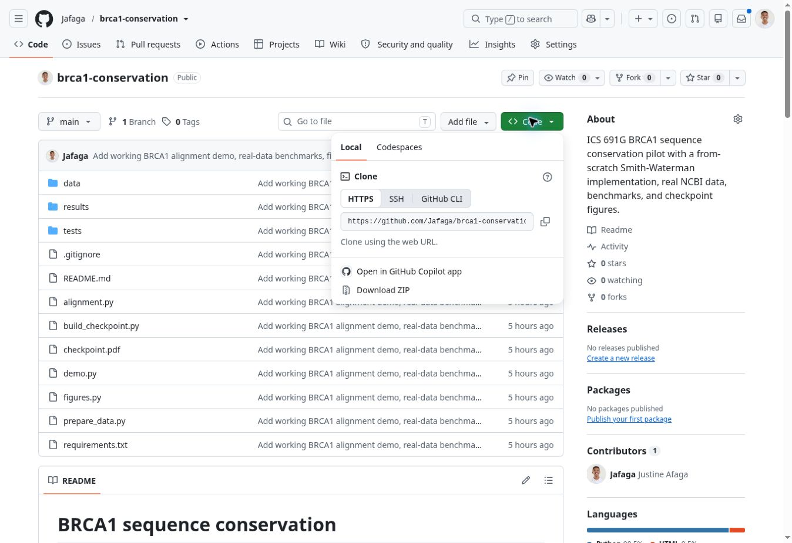

# BRCA1 conservation — an easy classroom demo

**How similar is the same gene across different species?** This program compares human BRCA1 DNA with chimpanzee, cat, and mouse DNA. Smith–Waterman finds a matching region and calculates a similarity score. The local browser demo explains each result as you go.


## Start on your own computer

You need **Python 3.10 or newer**, an internet connection for the first dependency installation, and a browser. The DNA sequences are already included. The instructions below support **macOS, Linux, and Windows through WSL/Ubuntu**. The command-line benchmarking code uses the Unix `resource` module.

### 1. Download the project

On this GitHub page, click the green **Code** button, choose **Download ZIP**, and extract it. Open the extracted folder. It should contain `classroom_demo.py`, `requirements.txt`, `web`, and `data`.



Open Terminal. Type `cd ` with a space after it, drag the extracted project folder into Terminal, and press Enter on a Mac. On Linux or WSL, use `cd` followed by the actual extracted folder path. Keep Terminal in that folder for the steps below.

If you already use Git, you can download it this way instead. Use this block once, from the folder where you want to keep the project.

```bash
git clone https://github.com/Jafaga/brca1-conservation.git
cd brca1-conservation
```

If you cloned this repository earlier, open that existing folder and run `git pull` to get the classroom demo. Keep any personal code changes committed before pulling.

### 2. Set up Python once

Copy these commands into Terminal, one line at a time.

```bash
python3 --version
python3 -m venv .venv
source .venv/bin/activate
python -m pip install -r requirements.txt
```

The version should be 3.10 or newer. After activation, Terminal usually shows `(.venv)` at the start of the prompt. Wait for installation to finish before continuing. Python installers are available at [python.org](https://www.python.org/downloads/).

### 3. Start the demo

```bash
python classroom_demo.py
```

Your browser should open automatically. If it does not, open **http://127.0.0.1:8000** in your browser. Terminal should print the following address.

```text
BRCA1 classroom demo
Open http://127.0.0.1:8000
Keep this Terminal window open. Press Ctrl+C to stop.
```

Keep Terminal open while presenting. Stop the server by pressing **Ctrl+C** in Terminal when you finish.

### Next time you present

Open Terminal in the project folder, then run these two lines. You can reuse the environment and installed packages.

```bash
source .venv/bin/activate
python classroom_demo.py
```

## What to click and what to say

### First, click “Try a small example”

The two toy sequences are `TTACGTAA` and `GGACGTCC`. The matching piece is `ACGT`.

> “I’ll start with two short examples so we can check the result ourselves. Both contain ACGT. There are four matching letters, and each match earns two points, so the score is eight.”

The screen also explains **100% identity** and **50% coverage**. All four letters in the alignment match. That alignment covers four of the eight letters in each original input.


### Then, click “Run the real DNA demo”

Wait for **Run complete**. Python reads the bundled NCBI data and recalculates all 18 comparisons. It uses three non-overlapping 600-base pieces from each coding sequence. Nine comparisons use real DNA and nine use shuffled controls.

> “Now I’m using actual BRCA1 DNA from NCBI. I compare human DNA with the same gene in chimpanzee, cat, and mouse. This small run uses three pieces from each sequence.”

Point to the three species rows. The row values average the three real comparisons for that species.


| Screen label | Plain-language meaning | What to point out |
|---|---|---|
| Alignment score | Matches earn points. Mismatches and gaps cost points. | Chimpanzee has the highest score in these selected pieces. |
| Matching letters | Percent identity within the local alignment, including gap columns in the denominator. | Chimpanzee is about 99.2%, cat about 88.3%, mouse about 78.5%. |
| Human piece covered | Fraction of the human input piece used by the alignment. | Check coverage alongside identity. |
| Alignment runtime | Time spent calculating the alignments in a fresh Python process. | This is measured again on the computer running the demo. |
| Peak Python process memory | Maximum resident memory of the benchmark process, measured before plotting imports. | Memory includes Python and the alignment data structures. |

> “Chimpanzee has the highest similarity to human in these pieces. That matches the direction of my hypothesis. This is still a small pilot using one gene, and I need more sequences before making broader conclusions.”

### Open the optional details if your audience asks

- **Scientific figure and shuffled controls** shows the original score, identity, and coverage plots. Shuffled DNA keeps the same letters in a different order.
- **Exact sequences used** shows the species, transcript accession, and complete coding-sequence length.
- **One real alignment** shows actual aligned letters with matching columns marked by `|`.


The GitHub download image is a browser screenshot. The three classroom images are rendered interface previews populated with results from a successful Python run. The scientific figure is the actual plot from that run. The local demo calls Python for fresh calculations. Runtime and memory vary across computers and runs.

## A three-minute presentation

| Time | Action | Main point |
|---|---|---|
| 0:00–0:30 | Show the page title. | “I’m studying how conserved BRCA1 is across species.” |
| 0:30–1:10 | Run the small example. | Explain ACGT, four matches, and a score of eight. |
| 1:10–2:10 | Run the real DNA demo. | Explain the species table and compare similarity. |
| 2:10–2:40 | Point to runtime and memory. | Show that the prototype calculates and measures actual work. |
| 2:40–3:00 | State the next step. | “Next I’ll use full sequences, more orthologs, and HPC.” |

Practice once before class so packages are installed. The local DNA run needs no additional downloads. For a saved-results fallback, open `results/report.html` directly. It contains the previously measured checkpoint run and its figures.

## Troubleshooting

| What you see | What to do |
|---|---|
| `python3: command not found` | Install Python 3.10 or newer, reopen Terminal, then check `python3 --version`. |
| `No such file` or `can't open file` | Run `pwd` and `ls`. Move into the extracted project folder where `classroom_demo.py` is listed. |
| `ModuleNotFoundError` | Activate `.venv` and run `python -m pip install -r requirements.txt`. Restart the demo. |
| Browser did not open | Copy the printed local address into your browser. Keep Terminal running. |
| `Address already in use` | Run `python classroom_demo.py --port 8001`, then open the printed address using port 8001. |
| Browser says it cannot connect | Restart `python classroom_demo.py` in the activated environment and use its exact printed address. |
| Windows reports `No module named resource` | Run the project inside WSL/Ubuntu. Native Windows benchmarking is currently unsupported. |
| Results take a while | Wait for “Run complete.” Terminal shows the requests and any Python errors. |

## For classmates or the professor reviewing the code

| File | Purpose |
|---|---|
| `alignment.py` | Smith–Waterman recurrence and traceback implemented from scratch. |
| `classroom_demo.py` | Local server. Connects the buttons to Python calculations. |
| `web/` | Classroom interface and explanations. |
| `demo.py` | Reproducible command-line pilot with measured runtime and memory. |
| `data/manifest.json` | Exact NCBI accessions, lengths, retrieval details, and checksums. |
| `tests/test_alignment.py` | Toy checks and independent Biopython score validation. |
| `results/` | Previously measured checkpoint outputs, alignments, and figures. |
| `checkpoint.pdf` | Checkpoint write-up. |
| [Methods and reproducibility](docs/METHODS.md) | Detailed sampling, algorithm, metrics, limitations, and scaling discussion. |

Run validation or recreate the saved report from Terminal.

```bash
python -m unittest discover -s tests -v
python demo.py
```

`python demo.py` replaces the files in `results/` with a newly measured run. The browser's **Run the real DNA demo** action uses a temporary output directory and keeps the bundled checkpoint outputs intact.
